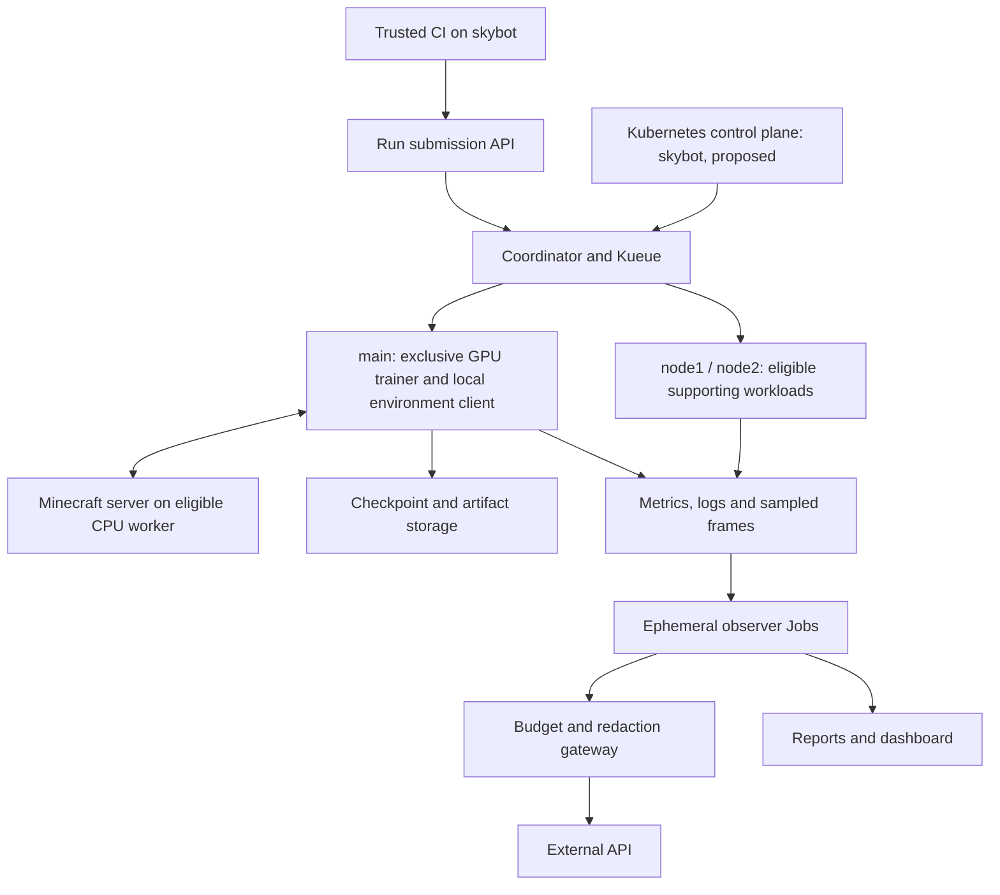

# Cluster platform and resource placement

> **Document control:** ARC-007 · Architecture / infrastructure · **State:** Proposed; no cluster changes made · **Custodian:** Repository maintainer · Revision history: Git.

**Date:** 2026-10-28. Requirements: [GOV-017](../governance/gov-017-cluster-and-aiops-proposal.md). Installation: [OPS-011](../operations/ops-011-owner-led-kubernetes-installation.md). Security: [SEC-002](../security/sec-002-cluster-and-aiops-threat-model.md).

## 1. Topology

`main` is the documented logical GPU host name, pending inventory. `skybot`, `node1`, and `node2` are separate Linux machines with owner-reported 2 CPUs and 8 GB RAM each. Actual scheduler capacity is reduced by operating systems, daemons and existing services.

## 2. Proposed node roles

| Node | Initial role | Placement rule |
|---|---|---|
| `main` | GPU worker; trainer, environment client/rendering and minimal exporters | GPU-required workloads select this node; general supporting workloads excluded |
| `skybot` | Single control plane, current Actions runner retained outside cluster initially | Keep control-plane taint; no general application placement until capacity proven |
| `node1` | CPU worker; candidate Minecraft host and stateless services | Stateful volume locality and available CPU decide actual placement |
| `node2` | CPU worker; candidate artifact/backup service and monitoring | Storage locality first; observation can move to any eligible CPU worker |

This is a placement proposal, not a report of live services. Existing services on node1/node2 must be inventoried before assigning anything. If the runner competes with the control plane on skybot, move the proposed control plane to the least-loaded CPU node before installation. Do not squeeze both onto a saturated two-CPU machine.

CPU labels express capabilities, not an entitlement to run on every node. Use requests, limits, topology preferences and affinity to allow stateless supporting pods to move among eligible nodes. skybot may join that pool later through a deliberate control-plane toleration for selected small services, only after runner/control-plane reservations are verified. Do not globally remove its taint. Storage-bound services cannot float to an arbitrary node without a working storage attachment or replication design.

## 3. Platform choices

Propose kubeadm for owner-led administration practice, containerd runtime, Calico networking in a selected supported configuration, and Kubernetes NetworkPolicy enforcement. Pin a mutually supported Kubernetes/CNI/runtime version set in the implementation record. Existing installation commands or packages are inputs to inventory, not a reason to initialize another cluster over an existing one.

Install NVIDIA runtime integration and device plugin on the GPU worker, retaining a compatible existing host driver where possible. Start with one advertised exclusive GPU allocation and no sharing. If inventory reveals multiple GPUs, the initial training concurrency remains one until a separate change permits more. Avoid a full GPU Operator unless its extra lifecycle management justifies the resource and upgrade overhead. See [NVIDIA device plugin](https://github.com/NVIDIA/k8s-device-plugin).

Use Kueue for GPU Job admission and priority. A small coordinator manages application lifecycle, state locks, environment readiness and continuous-segment resubmission. Neither Kueue nor kube-scheduler saves the brain, provisions a consistent world, or interprets research gates. See [ARC-008](arc-008-training-run-lifecycle.md).

## 4. Capacity envelope

The following values are proposed sizing inputs, not install-ready manifests. CPU values are cores; memory is GiB. Validate both steady state and peaks. Reserve at least 0.5 CPU and 1.5 GiB per CPU worker for its OS, kubelet, CNI and unexpected activity; the control plane needs a separately measured, larger reserve. Account for every existing outside-Kubernetes service explicitly.

| Workload | Initial CPU request / limit | Memory request / limit | Concurrency |
|---|---|---|---|
| Coordinator and submission API combined | 0.10 / 0.30 | 0.20 / 0.50 | 1 |
| Budget gateway and ledger | 0.10 / 0.30 | 0.20 / 0.50 | 1 active writer |
| Observer Job | 0.10 / 0.40 | 0.15 / 0.40 | 1 initially |
| Prometheus | 0.20 / 0.50 | 0.50 / 1.00 | 1 |
| Grafana | 0.10 / 0.30 | 0.25 / 0.50 | 1 |
| Artifact service | 0.10 / 0.40 | 0.25 / 0.75 | 1 |
| Minecraft server | 1.00 / 1.50 | 2.00 / 3.00 | 1 initially |
| CNI, DNS, Kueue, collectors | Measure selected versions together | Measure selected versions together | Included in admission budget |
| Trainer and rendering client | Measure on `main` | Measure CPU RAM and GPU VRAM separately. Existing measurements ([CLAUDE.md](../../CLAUDE.md) sections 6 and 10): a 16 GB host, 8 GB VRAM, trainer RSS 9.2 to 9.6 GB steady and 11.2 GB at a resume with Doom alone, and two Minecraft Java clients add about 5 GB, so kubelet, runtime and system reserves on `main` are not free | 1 GPU segment |

Example worker request placement: node1 can fit Minecraft plus the coordinator at 1.10 CPU before other services; node2's four listed storage/monitoring/gateway requests sum to 0.50 CPU. That is only a starting calculation. Validate daemon requests, disk I/O, limits under concurrent peaks and the existing workload inventory before accepting it. If no node fits a request, leave it pending with a reason. Spare aggregate RAM does not compensate for insufficient per-node CPU.

Set namespace quotas, ephemeral-storage limits, bounded log volumes and a one-observer concurrency limit. Avoid installing a service mesh, distributed log search, distributed block storage, multiple dashboards or three control planes in the first release. Reuse the current Prometheus/Grafana stack where practical, then move it one service at a time.

## 5. Network and service model

Use internal Kubernetes Services for application APIs and Minecraft; keep trainer/client latency-sensitive interaction local to `main` initially. The Java/MineRL client remains part of the runtime packaging work; the Minecraft server alone is not the environment. Validate service address configuration instead of assuming the historical localhost tunnel remains appropriate.

The run API, telemetry API, report interface and artifact endpoints authenticate workload identities and authorize run-specific paths. The trainer needs no Kubernetes administration credential. Observers call the telemetry/report gateway and have no direct trainer shell or control API. The budget gateway alone reaches the external model endpoint. Human dashboards use authenticated private access; no public NodePorts for Minecraft, RCON, metrics or administration.

Kubernetes NetworkPolicy is an allowlist primitive enforced by the selected networking implementation. Provider hostname filtering requires an egress proxy or a verified CNI capability; do not pretend a basic NetworkPolicy expresses an arbitrary FQDN. Host firewall rules cover node services and runtime endpoints separately. See [Kubernetes NetworkPolicy](https://kubernetes.io/docs/concepts/services-networking/network-policies/).

## 6. Persistence and idle behavior

Keep cluster control plane, DNS/networking, coordinator, telemetry collection and budget service available. Optional observer and analysis Jobs exit after bounded work; finished Job cleanup follows artifact persistence. Scale an optional Deployment to zero through its owner if that model is later used; deleting one of its pods will not keep it off.

Minecraft is started per run or segment group, saved, and stopped when no admitted run needs its world. A continuous run waiting behind higher-priority work should not retain a ticking world unless its protocol explicitly requires it and capacity is reserved. Training artifacts outlive Jobs and namespace cleanup. [OPS-010](../operations/ops-010-cluster-storage-and-recovery.md) controls retention and restoration.

## 7. Availability limits

One control plane is a single scheduling/control failure point; already-running pods may continue during an outage, but rescheduling and admission are unavailable. One GPU host means no training failover. A local volume ties a service to its node. Three machines on the same power/network are not three independent disaster domains. Validate restoration before considering automatic movement of stateful services.

<!-- backlinks:start (generated by tools/doc_backlinks.py; do not edit) -->
## Referenced by

- [ADR-008](../decisions/adr-008-cluster-orchestration-and-observer-boundary.md): Cluster orchestration and read-only AIOps boundary
<!-- backlinks:end -->
