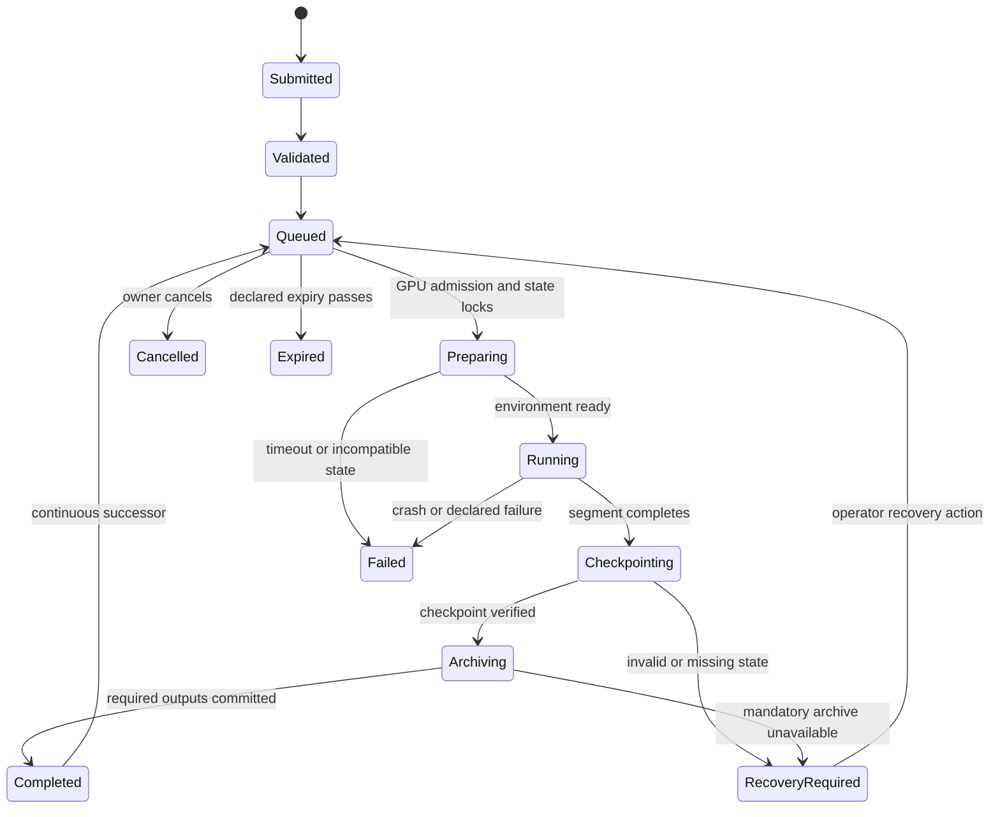

# Training run contract, queue and environment lifecycle

> **Document control:** ARC-008 · Architecture / workload orchestration · **State:** Proposed; interfaces and defaults not implemented · **Custodian:** Repository maintainer · Revision history: Git.

**Date:** 2026-10-28. Requirements: [GOV-017](../governance/gov-017-cluster-and-aiops-proposal.md). Platform: [ARC-007](arc-007-cluster-platform.md). Delivery: [OPS-009](../operations/ops-009-cluster-delivery-and-operations.md).

## 1. Terms and invariants

A **run** is the owner's experiment or continuous training intention. A **segment** is a bounded executable unit with its own Job and final checkpoint. An **attempt** is one execution of a segment; retries preserve the segment identity but receive new attempt identifiers.

Only one training segment owns the GPU at a time. Allocation is based on declared resources, never a low utilization sample. All GPU consumers, including evaluation or rendering that needs exclusive GPU access, must be accounted for. Host-side trainers must be drained before Kubernetes becomes the authority.

Priority changes admission order; it does not kill an active segment. Autonomous AIOps output cannot change priority, a checkpoint, a world, a protocol or a run configuration. The deterministic coordinator handles only lifecycle operations already declared in the run request.

## 2. Proposed run request contract

The future schema must reject unknown fields, unauthorized priorities, arbitrary shell commands and incompatible artifacts. A reviewed template supplies the executable entry point.

| Field group | Required content |
|---|---|
| Identity | Immutable run ID, idempotency key, requester identity, CI workflow/run ID, creation time |
| Provenance | Commit SHA, image digest, dependency manifest, configuration digest, protocol ID/version, seeds |
| Scheduling | `urgent`, `normal` or `continuous`; finite/continuous mode; bounded active duration or steps; optional deadline |
| Resources | GPU requirement, CPU/RAM/ephemeral-storage requests, approved environment profile |
| Brain | Brain lineage ID, immutable input checkpoint ID/hash or explicit fresh initialization, core/architecture identity |
| Environment | Game/adapter version, timing model, seed/map, server/client versions and asset references |
| World | Explicit `resume` plus world ID/version, or `baseline_clone` plus immutable baseline ID/hash |
| Continuation | Segment boundary policy, maximum drain duration, cancellation policy, retry cap, resume/reset semantics |
| Outputs | Authorized artifact prefix, retention class, report destination and data-disclosure profile |

World mode is mandatory for Minecraft and explicitly not applicable for environments without a separate persistent world. A baseline clone is written to a new run-specific volume. It never overwrites the baseline. Brain choice and world choice are separate: resuming a brain does not silently select its previous world.

## 3. Scheduling policy

Propose a Kueue ClusterQueue with exclusive GPU quota and no preemption, plus authorized workload priorities: urgent > normal > continuous; FIFO among equal-priority ready requests. Kubernetes Pod PriorityClasses also use non-preempting behavior. Kueue admission priority and pod priority are distinct settings; configure and test both. [Kueue ClusterQueue](https://kueue.sigs.k8s.io/docs/concepts/cluster_queue/), [Kubernetes non-preempting priority](https://kubernetes.io/docs/concepts/scheduling-eviction/pod-priority-preemption/).

Continuous training uses **30 minutes of active training** per segment by proposal, followed by a checkpoint/drain allowance initially targeted at **5 minutes**. Only one successor segment is eligible per continuous run. At completion the successor returns to the queue and urgent work can be admitted first. A finite task finishes its declared unit without priority-driven interruption. Frozen experiments retain their declared duration, seeds and phase boundaries.

An urgent task arriving one minute into a continuous segment normally waits up to approximately 29 minutes plus drain, environment startup and any urgent work ahead. This is a planning estimate, not a deadline guarantee. A finite multi-hour task can produce a much longer wait. Before admission, display estimated start and deadline feasibility; expire an unstarted request if its declared expiry requires that behavior. Never silently shorten the active experiment to meet a deadline.

Propose a report when continuous work has waited four hours. Do not automatically promote it above urgent work: the owner can change the queue or priority. Restrict who can submit urgent work and bound its queued count to prevent unlimited priority flooding.

## 4. Lifecycle and coordination

Cancellation and expiry are explicit terminal states with reason codes. A stop request drains at the declared safe boundary; a separate emergency operator stop can terminate immediately and records the interruption. AIOps cannot issue either.

Implementation proposal: submit the training Job suspended for Kueue management. After admission, its small bootstrap stage registers readiness intent and waits for the coordinator to prepare the environment. The coordinator obtains a brain/world writer lock, starts the server if required, verifies readiness and releases the training start gate. Admission can reserve the GPU while environment preparation consumes CPU; preparation has a bounded timeout and must relinquish the slot on failure. This avoids starting every queued Minecraft world in advance. Validate the exact integration against the pinned Kueue version; this is an application protocol, not an implicit Kueue feature.

Use persistent coordinator state, deterministic names and idempotent transitions so a controller restart reattaches rather than submits duplicate work. Reconcile run ID, Job UID, attempt, locks and committed output manifest before retrying. Queue dependencies and research gates from [ASS-013](../assurance/ass-013-unattended-test-campaign.md) remain authoritative; the existing campaign cannot run as a competing second GPU dispatcher.

GPU allocation and run completion are separate states. After the trainer safely commits local state and exits, its GPU allocation can be released while a storage task archives the generation. The logical run remains Archiving; its successor is ineligible until the required durable copy is verified. An independent urgent run can use the released GPU if its own inputs, storage and locks are ready. The coordinator must withhold automatic Job cleanup until required logs and artifacts are durable; do not enable a blanket TTL that can erase evidence during an archive outage.

Two requests referencing the same mutable brain/world lineage cannot both write it. A finite comparison normally receives an isolated copy of a named immutable input generation; the one universal brain architecture does not require concurrent experiments to share writable files. An urgent request requiring a locked or uncommitted input remains blocked with that reason, regardless of priority.

## 5. Checkpoint and single-writer contract

Save the model/core, optimizer, replay data or its validated reference, RNG states, learning counters, schedules, curiosity/memory state and every component needed for the declared continuation semantics. Inventory what `scripts/run.py` actually persists; do not assume model weights alone are sufficient.

Write to a new checkpoint generation, flush, hash and validate it, then atomically commit its manifest/pointer. Upload required durable artifacts and verify them before marking the segment complete. State locks include monotonically increasing fencing generations enforced on writes; a lease timeout alone is insufficient when an old process survives a network partition. A replacement writer starts only after the old writer is fenced or confirmed stopped. Kubernetes volume access modes alone do not establish application exclusivity.

A 30-minute segment does not imply exact environment continuation. If an adapter cannot snapshot transient state, declare episode-boundary segmentation or a documented reset, and validate its impact before using it in a frozen experiment. Minecraft uses a coordinated save/stop and paired brain/world manifest; saving two files at unrelated times is not an atomic experiment snapshot.

Termination grace must exceed measured checkpoint/drain time. A timeout reports recovery required and preserves the last verified generation. Do not use a hard Job deadline as the normal checkpoint trigger; abrupt termination is a failure path. A failed checkpoint must not be labeled a completed segment to free the queue silently.

## 6. Environment lifecycle

Minecraft server uses an internal Service and persistent world volume with run-specific access. Check actual server readiness, compatible protocol/plugins and client connection before starting the training clock. Keep RCON private and give any required credential only to the narrow environment controller. The initial MineRL rendering/client runtime stays on the GPU host; relocating it is a separate latency experiment.

At completion, stop stepping, checkpoint the brain and environment according to the adapter's declared ordering, save and stop the server, archive artifacts and release locks. For baseline mode retain the immutable baseline and apply the run's retention class to its clone. For resume mode retain the updated world and its paired checkpoint generation. A resumed continuous run uses its own prior lineage after urgent work; it does not inherit the urgent run's output automatically.

## 7. Failure and retry policy

Propose at most one automatic retry for a classified transient startup failure, with backoff and a new attempt ID. Training crashes, unknown persistence failures and scientific protocol violations stop automatic retries until the declared recovery policy permits replay. Non-retryable errors expose a reason and recovery action. Kubernetes Job retries must not multiply application retries; choose one retry owner.

Training startup, progress heartbeats and checkpointing require distinct probes. A long update or save is not automatically a dead process. Detect stale telemetry separately from stalled learning. Recovery, cleanup and protection against lost checkpoints are specified in [OPS-010](../operations/ops-010-cluster-storage-and-recovery.md).
